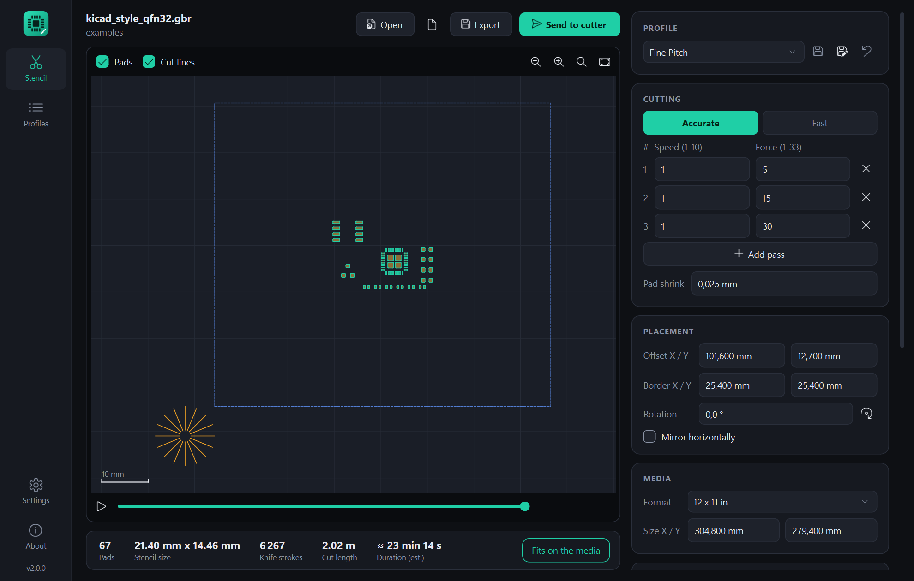
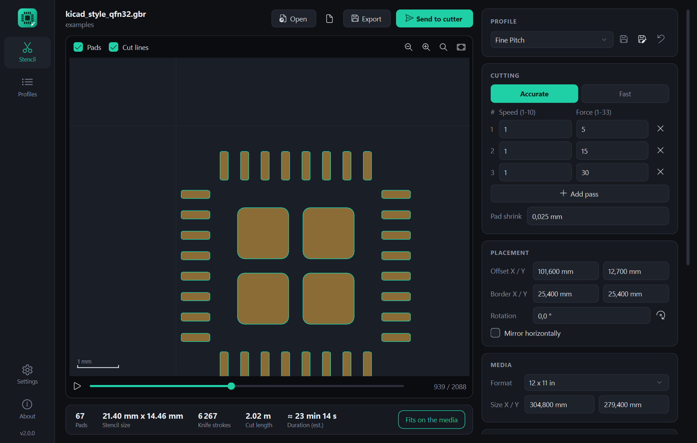
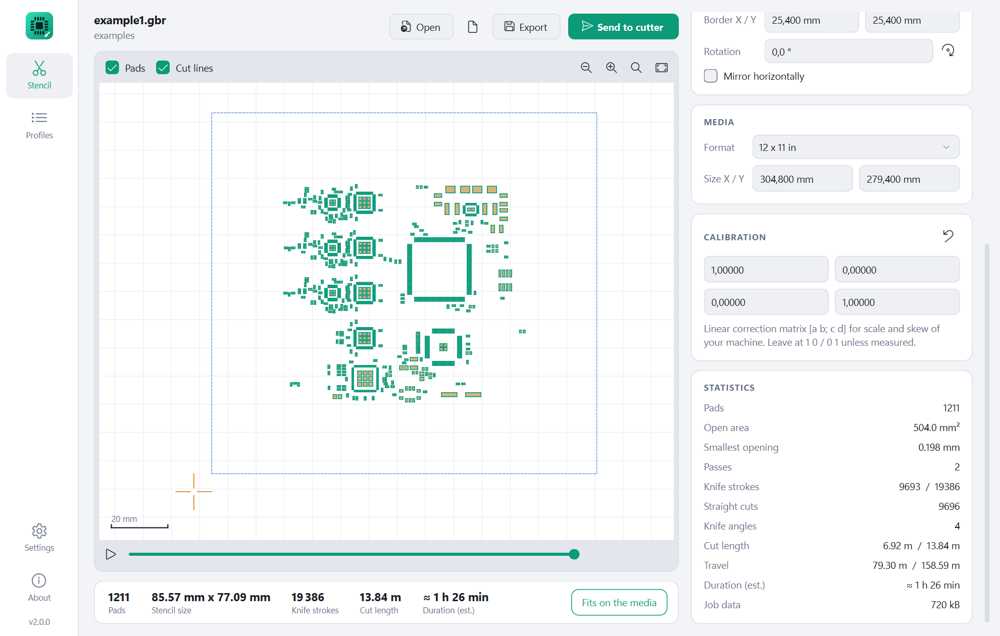
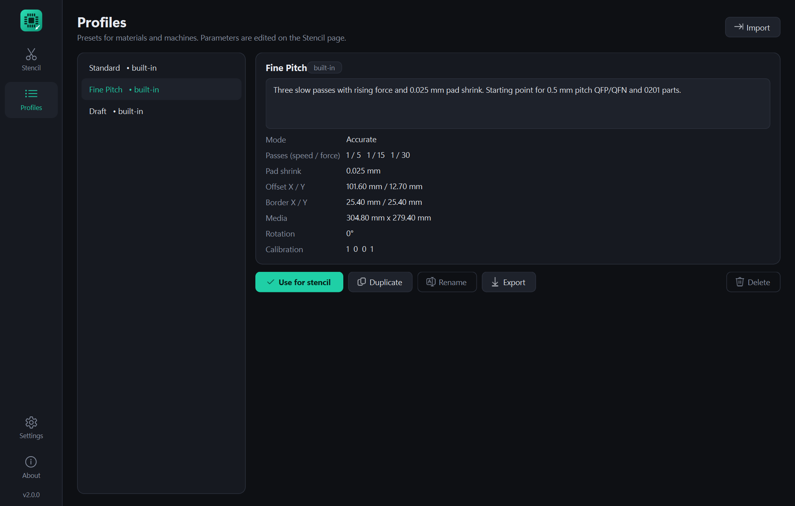
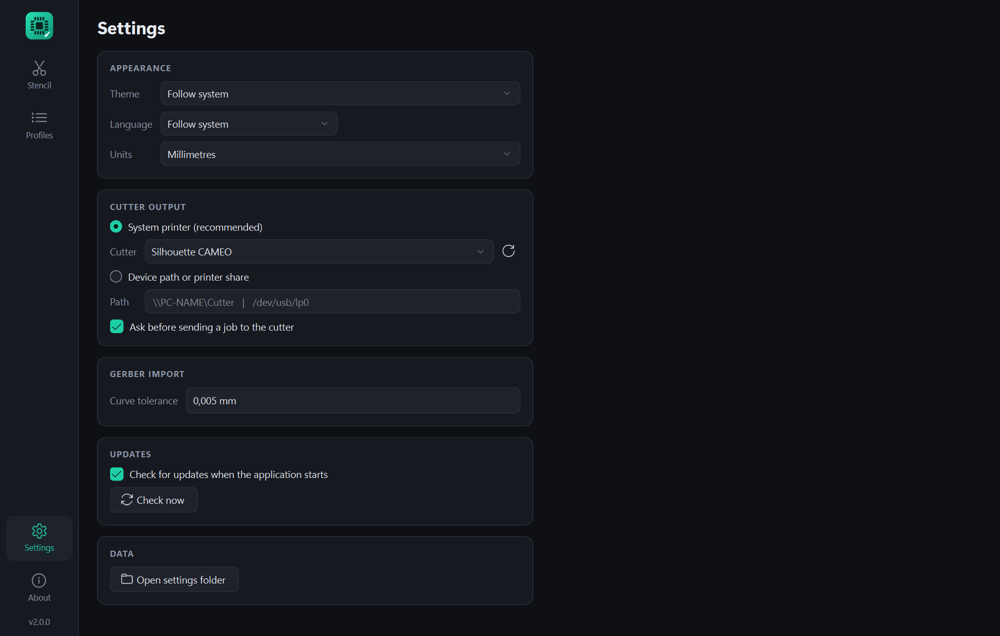

# Gerber2Graphtec

Cut fine-pitch SMT solder paste stencils from Gerber files on Graphtec craft
cutters (Silhouette Cameo, Portrait, ...). A modern rewrite of
[gerber2graphtec](https://github.com/pmonta/gerber2graphtec) with a desktop
application for Windows and Linux.

[](https://github.com/reserve85/Gerber_to_Graphtec_modern/actions/workflows/ci.yml)
[](https://github.com/reserve85/Gerber_to_Graphtec_modern/releases/latest)
[](LICENSE)



| | |
|---|---|
|  Simulation of the cutting order, zoomed in |  Statistics and light theme |
|  Profiles |  Settings |

## What's new compared to the original

- **No external tools.** Gerber files are read natively (RS-274X incl. aperture
  macros, regions, arcs, polarity). gerbv, pstoedit and Ghostscript are no
  longer needed.
- **Live preview** of the media, pads, frame cut and every single cut line,
  with zoom/pan and a simulation of the cutting order.
- **Profiles** for materials and machines (built-in presets, your own,
  import/export as JSON).
- **Statistics**: pads, knife strokes, cut length, travel, smallest opening,
  estimated duration.
- **Pad shrink** to compensate the knife widening the openings.
- **Direct output** to the cutter as a RAW job on an installed printer
  (Windows spooler / CUPS), to a device path, or export to a file.
- Settings page, dark/light theme, German/English, mm/inch, update check
  against the GitHub releases, single-file executable.

The cutting strategy itself is unchanged and verified against the original
code by the test suite: every pad edge is cut as an individual line in both
directions, grouped by knife angle, and each angle group starts with a short
training cut outside the stencil that aligns the drag knife.

### Verified against the original tool chain

The test suite compares the pads read by the native Gerber reader with the
output of the original chain (gerbv 2.6.1 -> PDF -> pstoedit -> pic) for all
example files. Straight-edged pads agree to within 3 micron. Three
differences are intended, because the original chain was wrong there:

- pstoedit turned **round pads into coarse 8-point diamonds** (about 80 % of
  the area); they are now cut round within the *curve tolerance* setting.
- gerbv **dropped 3 of the 27 round pads** in `fine_pitch_sampler.gbr`.
- The old GUI called gerbv with `--border=0`, which **clipped pads at the
  edge** of the board (2 of 9 pads in `test_tiny.gbr`); the old command line
  (`--border=20`) did not.

With Gerber files from current CAD programs the original chain fails more
visibly (checked with the synthetic examples below): KiCad-style `RoundRect`
macro pads fall apart into five overlapping pieces, clear polarity is ignored,
and arcs drawn with a round aperture are lost or closed along the chord. The
native reader handles these according to the Gerber specification; the tests
check them against values calculated by hand.

## Example files

| File | What it exercises |
|---|---|
| `corners.gbr`, `test_tiny.gbr`, `test_0.5mm_0402.gbr`, `example1.gbr`, `fine_pitch_sampler.gbr` | Files of the original project (gEDA pcb / gerbv, inch) |
| `kicad_style_qfn32.gbr` | mm, 4.6 format, X2 attributes, `RoundRect` aperture macros: QFN-32 0.5 mm, SOIC-8, SOT-23, 0402, 0603 |
| `bga100_0.8mm.gbr` | Round pads: BGA-100 with 0.8 mm pitch and fiducials |
| `arcs_regions_polarity.gbr` | Regions with arcs, arc draws, obround / polygon / rotated macro apertures, clear polarity, aperture transformations |
| `legacy_inch_soic.gbr` | Old inch style: trailing zero omission, `G70`/`G90`, `G54`, modal operation codes |

The last four are synthetic: they are written by `scripts/make_examples.py`,
not exported from a CAD program.

## Install

**Windows:** download `Gerber2Graphtec-x.y.z.exe` from the
[releases](https://github.com/reserve85/Gerber_to_Graphtec_modern/releases) and run it. No installation needed.

**Linux:** download the `linux-x86_64` archive from the releases, or run from
source:

```bash
pip install .
gerber2graphtec
```

The cutter must be reachable either as a print queue (`lpstat -e`) or as a
device node such as `/dev/usb/lp0` (add yourself to the `lp` group).

## Usage

**Full documentation: [User manual](docs/manual.md) - [Benutzerhandbuch (Deutsch)](docs/handbuch.md)**

In the application, *About > User manual* or `F1` opens it.

In short:

1. Open or drop the solder paste Gerber of your board.
2. Pick a profile, adjust passes (speed / force), placement and media.
3. Check the preview and statistics.
4. *Send to cutter* - or *Export* the command file.

Select the cutter once under *Settings > Cutter output*.

Shortcuts: `Ctrl+O` open, `Ctrl+E` export, `Ctrl+Enter` send, `F5` reload,
`Ctrl+,` settings. Mouse wheel zooms, drag pans, double click fits the view.

### Command line

```bash
g2g-cli paste.gbr -o stencil.graphtec
g2g-cli paste.gbr --profile "Fine Pitch" --printer "Silhouette CAMEO"
g2g-cli paste.gbr --inch --offset 3,4 --matrix 1.001,0,-0.0005,0.9985 --speed 2,1 --force 5,25 > /dev/usb/lp0
```

## Tips

- Use 3-5 mil (0.08-0.12 mm) Mylar; typical laser transparency film works well.
- Speeds and forces depend on blade and material - start with a built-in
  profile and experiment. "Fine Pitch" and "Draft" are starting points, not
  measured values.
- The duration shown is an estimate from a simple machine model.

## Development

```bash
python -m venv .venv
.venv/Scripts/pip install -e ".[dev]"     # Linux: .venv/bin/pip
.venv/Scripts/python -m pytest            # tests, incl. a click on every button
.venv/Scripts/python -m ruff check .      # lint
.venv/Scripts/python -m ruff format .     # format
.venv/Scripts/python -m g2g
```

Build the executable with `./build.ps1` (Windows) or
`pyinstaller --noconfirm Gerber2Graphtec.spec`.

Helper scripts: `scripts/make_examples.py` (synthetic Gerber files),
`scripts/make_screenshots.py` (README images), `scripts/make_icon.py`,
`scripts/check_i18n.py` (German catalogue complete?).

### Continuous integration and releases

- **CI** (`.github/workflows/ci.yml`) runs on every push and pull request:
  Ruff lint and format check, translation and changelog check, tests on
  Python 3.10 / 3.11 / 3.13 on Windows and Linux, and a build of both
  executables (downloadable as workflow artifacts).
- **Release** (`.github/workflows/release.yml`): add a `## X.Y.Z` section to
  `CHANGELOG.md`, then either
  - run *Actions > Release > Run workflow* and enter the version - the
    workflow writes it into `src/g2g/__init__.py`, commits, creates the tag
    `vX.Y.Z` and publishes; or
  - set `__version__` yourself and push a tag `vX.Y.Z`.

  The release gets `Gerber2Graphtec-X.Y.Z.exe`, the Linux archive, checksums
  and the changelog section as text. The in-app update check looks at the
  latest release.

Layout: `src/g2g/core` (Gerber reader, tool path, Graphtec encoder, output -
no GUI dependencies), `src/g2g/ui` (Qt application), `tests/legacy` (the
original implementation, used as reference in the regression tests).

## Credits and license

Based on gerber2graphtec by Peter Monta (2012), the GUI by jesuscf and the
Python 3 port. Protocol knowledge from robocut and graphtecprint.
Licensed under the GNU General Public License v2 - see [LICENSE](LICENSE).
