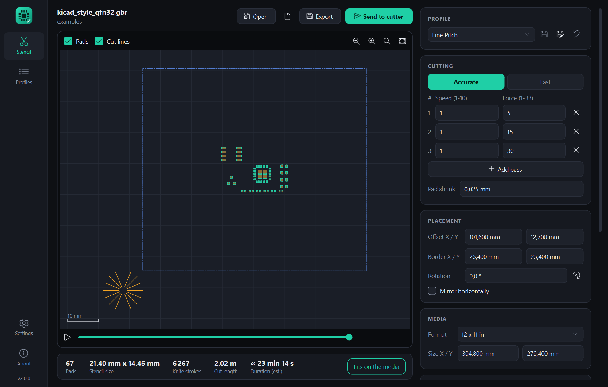
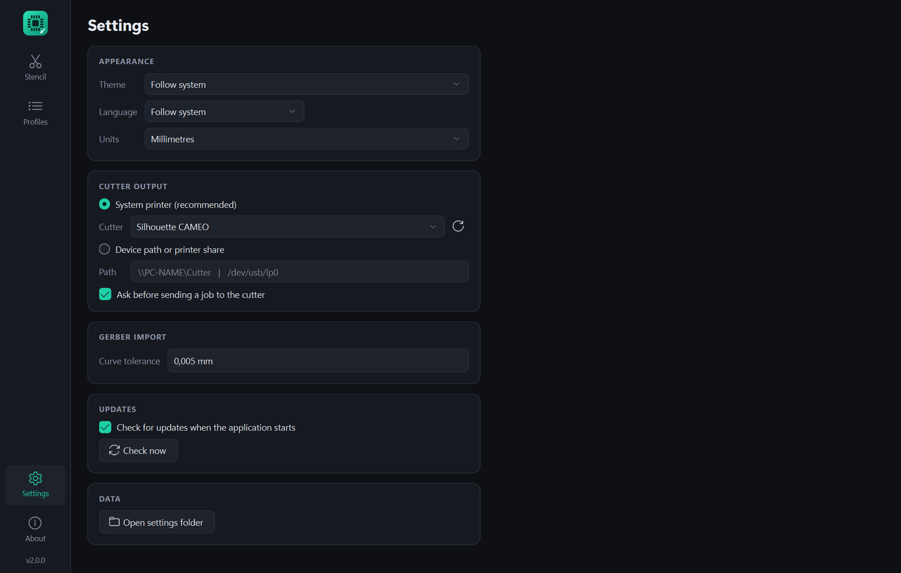
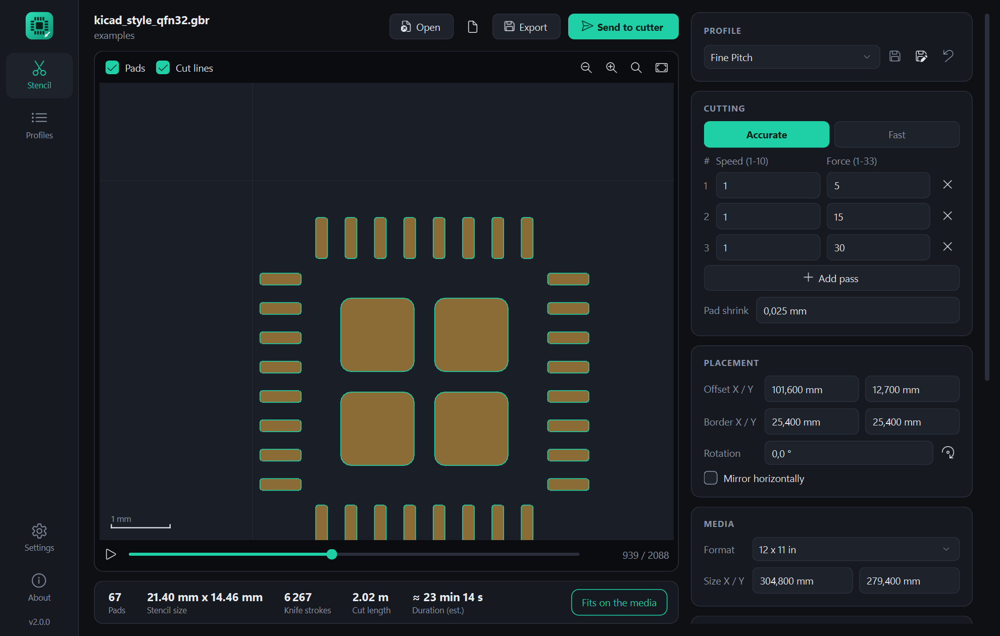
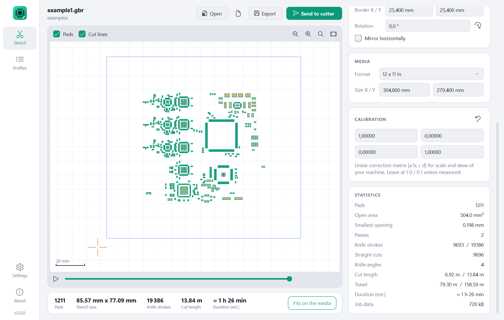
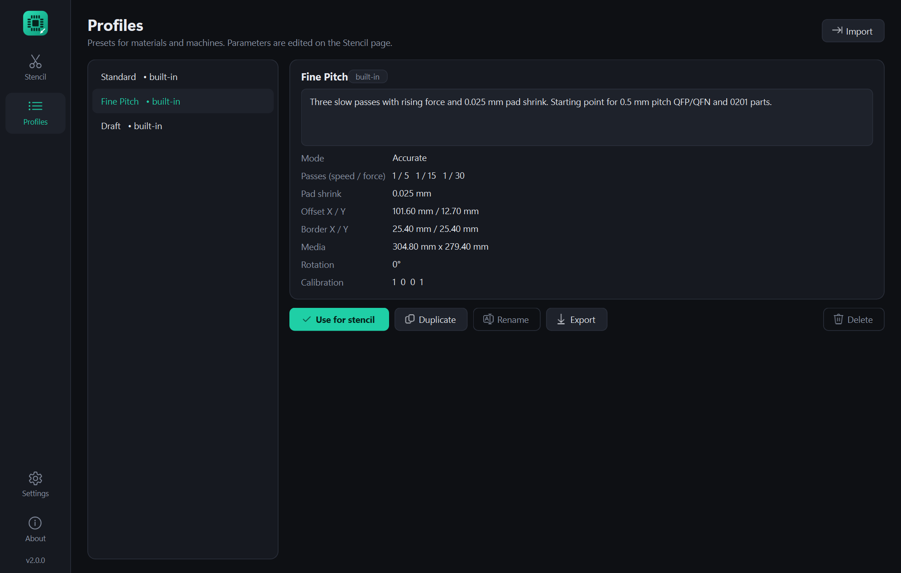

# Gerber2Graphtec - Benutzerhandbuch

[English version](manual.md)

Gerber2Graphtec schneidet Lotpastenschablonen für SMD-Platinen aus dünner
Kunststofffolie - auf einem Schneideplotter mit Graphtec-Technik wie dem
Silhouette Cameo oder Portrait. Sie laden die Lotpasten-Lage Ihrer Platine
als Gerber-Datei, prüfen die Vorschau und senden den Auftrag an den Cutter.

- [1. Was Sie brauchen](#1-was-sie-brauchen)
- [2. Installation](#2-installation)
- [3. Cutter anschließen](#3-cutter-anschließen)
- [4. Die erste Schablone](#4-die-erste-schablone)
- [5. Die Seite „Schablone"](#5-die-seite-schablone)
- [6. Profile](#6-profile)
- [7. Einstellungen](#7-einstellungen)
- [8. So funktioniert das Schneiden](#8-so-funktioniert-das-schneiden)
- [9. Tempo und Kraft ermitteln](#9-tempo-und-kraft-ermitteln)
- [10. Maschine kalibrieren](#10-maschine-kalibrieren)
- [11. Kommandozeile](#11-kommandozeile)
- [12. Unterstützte Gerber-Dateien](#12-unterstützte-gerber-dateien)
- [13. Fehlerbehebung](#13-fehlerbehebung)



Die Abbildungen zeigen die englische Oberfläche; die Bezeichnungen in diesem
Handbuch sind die der deutschen.

## 1. Was Sie brauchen

- Einen Cutter mit Graphtec-Technik: Silhouette Cameo, Portrait oder ein
  ähnliches Gerät, das die Graphtec-Befehlssprache (GP-GL) versteht.
- Folie: Mylar / Polyester mit 0,08 bis 0,12 mm Dicke (3 bis 5 mil).
  Gewöhnliche Overheadfolie für Laserdrucker liegt meist in diesem Bereich.
- Die **Lotpasten-Lage** der Platine als Gerber-Datei (RS-274X), zum Beispiel
  `*.gtp` / `*.gbp`, bei KiCad `*-F_Paste.gbr`, bei Eagle `*.GTP`.
- Windows 10 / 11 oder Linux (x86-64).

## 2. Installation

**Windows.** `Gerber2Graphtec-x.y.z.exe` von der
[Release-Seite](https://github.com/reserve85/gerber2graphtec-modern/releases/latest)
herunterladen und starten. Es wird nichts installiert, die Datei kann an
beliebiger Stelle liegen. Das Programm ist nicht signiert; Windows zeigt beim
ersten Start möglicherweise „Der Computer wurde durch Windows geschützt" -
dann *Weitere Informationen > Trotzdem ausführen* wählen.

**Linux.** `Gerber2Graphtec-x.y.z-linux-x86_64.tar.gz` herunterladen,
entpacken und die enthaltene Datei `Gerber2Graphtec` starten:

```bash
tar xzf Gerber2Graphtec-*-linux-x86_64.tar.gz
./Gerber2Graphtec
```

Alternativ aus dem Quelltext mit Python 3.10 oder neuer:

```bash
pip install .
gerber2graphtec
```

Einstellungen und Profile liegen pro Benutzer in
`%APPDATA%\Gerber2Graphtec` (Windows) bzw. `~/.config/Gerber2Graphtec`
(Linux). *Einstellungen > Einstellungsordner öffnen* führt dorthin. Wird der
Ordner gelöscht, startet das Programm wieder im Auslieferungszustand.

## 3. Cutter anschließen

Das Programm sendet den Auftrag als Rohdaten. Die Silhouette-Software und
ihr Treiber werden nicht verwendet. Die Ausgabe wird einmalig unter
**Einstellungen > Cutter-Ausgabe** gewählt:



### Windows

**Systemdrucker** wählen und den Cutter in der Liste auswählen. Ein Drucker,
dessen Name „Silhouette", „Cameo", „Portrait" oder „Graphtec" enthält, wird
automatisch vorausgewählt.

Fehlt der Cutter in der Liste, ist er noch nicht als Drucker eingerichtet.
Beim originalen gerber2graphtec wurde er dazu von Hand unter *Drucker &
Scanner* mit dem Treiber **Generic / Text Only** am USB-Anschluss des Cutters
hinzugefügt. Danach die Liste mit der Schaltfläche daneben aktualisieren.

Alternativ **Gerätepfad oder Druckerfreigabe** wählen und einen
Freigabenamen wie `\\PC-NAME\Cutter` eintragen.

### Linux

Entweder unter **Systemdrucker** die Druckerwarteschlange des Cutters (CUPS)
wählen, oder **Gerätepfad** wählen und den Geräteknoten eintragen, meist
`/dev/usb/lp0`. Dafür muss der Benutzer in der Gruppe `lp` sein:

```bash
sudo usermod -a -G lp $USER     # danach ab- und wieder anmelden
```

### Ohne Verbindung

Mit **Exportieren** lässt sich die Befehlsdatei jederzeit speichern und auf
anderem Weg an den Cutter senden.

## 4. Die erste Schablone

1. Die Lotpasten-Gerber-Datei **öffnen** oder auf das Fenster ziehen. Zum
   Ausprobieren ohne Platine eignet sich `examples/test_tiny.gbr` aus dem
   Repository.
2. Ein **Profil** wählen. *Standard* ist die bewährte Einstellung des
   Originalprogramms - damit beginnen.
3. Die **Vorschau** prüfen: Pads (gold), Rahmenschnitt (blau gestrichelt) und
   die Trainingsschnitte des Messers (orange) müssen auf dem Medium liegen.
   Unten rechts steht *Passt auf das Medium* oder eine Warnung.
4. Folie in den Cutter einlegen und das Messer einstellen.
5. **An Cutter senden** drücken und bestätigen.

Den ersten Schnitt mit neuem Material auf einem Reststück machen - siehe
[Kapitel 9](#9-tempo-und-kraft-ermitteln).

> **Ausrichtung.** X und Y in der Vorschau sind die Koordinaten, die an den
> Cutter gesendet werden. Wie sie zur Vorschubrichtung und zum Schlitten
> Ihrer Maschine liegen, zeigt am einfachsten ein Testschnitt von
> `examples/corners.gbr` auf Restfolie. Bei Bedarf danach *Versatz* und
> *Drehung* anpassen.

## 5. Die Seite „Schablone"

### Obere Zeile

| Element | Funktion |
|---|---|
| **Öffnen** (`Strg+O`) | Gerber-Datei laden. Ziehen und Ablegen geht ebenfalls. |
| Zuletzt geöffnet | Die letzten 8 Dateien. |
| **Exportieren** (`Strg+E`) | Graphtec-Befehlsdatei (`*.graphtec`) speichern. |
| **An Cutter senden** (`Strg+Enter`) | Auftrag an den in den Einstellungen gewählten Cutter senden. |

`F5` liest die aktuelle Datei neu ein, etwa nach einem erneuten Export aus
dem CAD-Programm.

Unter dem Dateinamen steht der Ordner oder ein Hinweis auf
**Import-Warnungen**. Der Tooltip zeigt sie an - zum Beispiel, wenn die Datei
etwas enthält, das sich nicht schneiden lässt.

### Vorschau

| Aktion | Wirkung |
|---|---|
| Mausrad | Zoom an der Mausposition |
| Ziehen | Ansicht verschieben |
| Doppelklick | Schnittbereich einpassen |
| Schaltflächen oben rechts | Verkleinern, vergrößern, auf Schablone zoomen, ganzes Medium zeigen |
| **Pads** / **Schnittlinien** | Ebenen ein- und ausblenden |

Das helle Rechteck ist das Medium mit 10-mm-Raster. Sein Rand wird rot, wenn
der Schnitt nicht darauf passt. Unten rechts steht die Mausposition auf dem
Medium, unten links ein Maßstab.

**Simulation.** Der Schieberegler unter der Vorschau geht die Schnitte in der
Reihenfolge durch, in der die Maschine sie ausführt; die Wiedergabetaste
lässt sie ablaufen. Bereits ausgeführte Schnitte sind hervorgehoben, der
aktuelle ist orange.



### Statusleiste

Pads, Schablonengröße, Anzahl der Hubbewegungen, gesamte Schnittlänge und die
geschätzte Dauer des gesamten Auftrags. Weitere Werte stehen in der Karte
*Statistik* (siehe unten).

### Parameter (rechte Seite)

Alle Längen lassen sich in Millimetern oder Zoll anzeigen
(*Einstellungen > Einheiten*). Jede Änderung aktualisiert die Vorschau sofort.

**Profil**

Ein Profil wählen, um seine Werte zu laden. *geändert* erscheint, sobald
etwas verstellt wurde. Die drei Schaltflächen speichern die Änderungen im
Profil, speichern sie als neues Profil oder verwerfen sie. Mitgelieferte
Profile lassen sich nicht überschreiben - dafür *Als neues Profil speichern*.

**Schnitt**

| Parameter | Bedeutung |
|---|---|
| **Präzise** | Jede Pad-Kante wird als einzelne Linie geschnitten. Langsam, beste Qualität, nötig für Fine Pitch. |
| **Schnell** | Jedes Pad wird als geschlossene Kontur geschnitten. Deutlich schneller, Ecken ungenauer. |
| Durchgänge | Der Auftrag wird je Zeile einmal geschnitten. **Tempo** 1 (langsam) bis 10, **Kraft** 1 bis 33. Bis zu 6 Durchgänge; ein leichter erster und ein kräftigerer zweiter Durchgang ergeben sauberere Kanten als ein einzelner kräftiger. |
| Pad-Verkleinerung | Verkleinert jede Öffnung an allen Seiten. Das Messer weitet Öffnungen in dünner Folie um etwa 0,05 mm (2 mil); 0,02 bis 0,05 mm gleichen das aus. |

**Platzierung**

| Parameter | Bedeutung |
|---|---|
| Versatz X / Y | Position der Schablone auf dem Medium. |
| Rand X / Y | Abstand des Rahmenschnitts um die Schablone. 0 / 0 schaltet den Rahmenschnitt ab. |
| Drehung | Dreht die Schablone gegen den Uhrzeigersinn; die Schaltfläche addiert 90 Grad. |
| Horizontal spiegeln | Spiegelt die Schablone. Meist unnötig: eine Schablone lässt sich einfach umdrehen. |

Neben dem Rahmen sind 12,7 mm (0,5 Zoll) für die Trainingsschnitte des
Messers reserviert. Die linke untere Ecke des Pad-Bereichs liegt daher bei
*Versatz + Rand + 12,7 mm*.

**Medium**

Größe der Folie bzw. des Schneidebereichs. Die Vorgaben tragen gängige
Formate ein, jede andere Größe kann eingetippt werden. Das Programm verwendet
sie nur für die Seitendefinition, die an den Cutter geht, und für die Prüfung
*Passt auf das Medium*.

**Kalibrierung**

Korrekturmatrix für Maschinen, die etwas zu lang, zu kurz oder schräg
schneiden. Ohne Messung bei `1 0 / 0 1` belassen
([Kapitel 10](#10-maschine-kalibrieren)).

**Statistik**



| Wert | Bedeutung |
|---|---|
| Pads | Anzahl der Öffnungen. |
| Offene Fläche | Gesamtfläche aller Öffnungen. |
| Kleinste Öffnung | Schmalste Pad-Abmessung - zeigt, wie anspruchsvoll die Schablone ist. |
| Durchgänge | Anzahl der Durchgänge. |
| Hubbewegungen | Wie oft das Messer abgesenkt und angehoben wird (pro Durchgang / gesamt). |
| Einzelschnitte | Anzahl gerader Schnitte pro Durchgang. |
| Messerwinkel | Anzahl der Winkelgruppen, jede beginnt mit einem Trainingsschnitt (Modus Präzise). |
| Schnittlänge | Strecke mit abgesenktem Messer (pro Durchgang / gesamt). |
| Leerfahrt | Strecke mit angehobenem Messer zwischen den Schnitten (pro Durchgang / gesamt). |
| Dauer (geschätzt) | Grobe Schätzung, siehe Hinweis unten. |
| Auftragsdaten | Größe der an den Cutter gesendeten Daten. |

Die **Dauer** stammt aus einem einfachen Modell: eine Tempo-Einheit =
10 mm/s, Leerfahrt mit 100 mm/s, 0,15 s pro Hubbewegung, dazu 10 s für das
Einziehen. Reale Maschinen weichen ab - der Wert dient zum Vergleichen von
Einstellungen, nicht als Zusage.

## 6. Profile



Ein Profil speichert alle Parameter der Seite „Schablone" - sinnvoll ist eines
je Material, Messer oder Maschine.

| Mitgeliefertes Profil | Inhalt |
|---|---|
| **Standard** | Modus Präzise, zwei Durchgänge (Tempo 2, Kraft 8 und 30). Die Standardwerte des Originalprogramms für 3 bis 5 mil Folie. |
| **Fine Pitch** | Drei langsame Durchgänge mit steigender Kraft (5, 15, 30) und 0,025 mm Pad-Verkleinerung. Ausgangspunkt für 0,5 mm Raster und 0201. |
| **Draft** | Modus Schnell, ein Durchgang. Für große Pads und Testschnitte. |

*Fine Pitch* und *Draft* sind Ausgangswerte, keine gemessenen Einstellungen.

Auf der Seite **Profile** lassen sich Profile duplizieren, umbenennen,
löschen, exportieren und importieren (JSON-Dateien, praktisch zum Weitergeben
oder Sichern) und mit einer Beschreibung versehen. *Für Schablone verwenden*
lädt das gewählte Profil auf der Seite „Schablone". Die Parameter selbst
werden dort bearbeitet und von dort gespeichert.

## 7. Einstellungen

| Einstellung | Bedeutung |
|---|---|
| Design | Dunkel, hell oder wie das System. |
| Sprache | Deutsch, Englisch oder wie das System. Wird nach einem Neustart wirksam. |
| Einheiten | Millimeter oder Zoll für alle Längenangaben. |
| Cutter-Ausgabe | Siehe [Kapitel 3](#3-cutter-anschließen). |
| Vor dem Senden nachfragen | Zeigt vor dem Start eine Bestätigung mit den Durchgangswerten. |
| Kurventoleranz | Maximale Abweichung, wenn runde Pads und Bögen in gerade Schnitte zerlegt werden (Standard 0,005 mm). Ein größerer Wert ergibt weniger, längere Schnitte und einen schnelleren Auftrag; ein kleinerer rundere Öffnungen. |
| Updates | Beim Start oder mit *Jetzt prüfen* nach einer neueren Version suchen. Es wird nichts automatisch installiert - das Programm öffnet nur die Download-Seite. |

## 8. So funktioniert das Schneiden

Ein Schleppmesser läuft seinem Drehpunkt hinterher. Ändert es in einem
winzigen Pad die Richtung, folgt die Spitze nicht exakt; Ecken werden rund
oder reißen aus. Der Modus **Präzise** vermeidet das:

- Jede Kante jedes Pads wird als **einzelne gerade Linie** geschnitten, und
  zwar **zweimal, einmal in jede Richtung**.
- Alle Linien werden **nach Richtung gruppiert** (16 Messerwinkel). Die
  Maschine schneidet erst alle Linien einer Richtung, dann die der nächsten.
- Vor jeder Gruppe dreht ein kurzer **Trainingsschnitt** außerhalb der
  Schablone (der orange Stern links unten) das Messer in die richtige
  Richtung.
- Jede Linie beginnt etwas früher und endet etwas später, um mechanisches
  Spiel auszugleichen.
- Der gesamte Ablauf wird für jeden **Durchgang** wiederholt.

Das ergibt sehr viele Hubbewegungen - eine Platine mit 1 200 Pads braucht
knapp 10 000 pro Durchgang -, präzise Aufträge dauern also lange. Das ist der
Preis für saubere Öffnungen bei 0,5 mm Raster. Der Modus **Schnell** schneidet
jede Pad-Kontur in einem Zug und eignet sich für große Pads.

## 9. Tempo und Kraft ermitteln

Die richtigen Werte hängen von Folie, Messerverschleiß und Messertiefe ab und
müssen ausprobiert werden:

1. `examples/test_tiny.gbr` laden (9 Pads, etwa eine Minute) oder einen
   kleinen Ausschnitt der eigenen Platine.
2. Mit dem Profil *Standard* beginnen, Messertiefe nur wenig größer als die
   Foliendicke.
3. Schneiden und gegen das Licht prüfen: Pads sollen herausfallen oder sich
   leicht herauslösen, die Kanten sauber sein.
4. Pads nicht durchgeschnitten: **Kraft des letzten Durchgangs** erhöhen oder
   einen Durchgang hinzufügen.
5. Folie reißt, Pads sind verzogen oder die Schneidematte wird tief
   eingeschnitten: Kraft senken, Tempo senken oder Messertiefe verringern.
6. Öffnungen für Fine Pitch zu groß: **Pad-Verkleinerung** in Schritten von
   0,01 mm erhöhen.
7. Das Ergebnis als eigenes Profil speichern.

`examples/fine_pitch_sampler.gbr` enthält verschiedene Pad-Größen und Raster
und zeigt, wie fein die eigene Ausrüstung schneiden kann.

## 10. Maschine kalibrieren

Nur nötig, wenn Schablonen über größere Strecken nicht zur Platine passen.

1. `examples/corners.gbr` laden. Die Datei enthält vier quadratische Pads von
   1 mm, deren Mittelpunkte in X und in Y genau 126,0 mm auseinanderliegen.
2. Mit der Matrix `1 0 / 0 1` schneiden.
3. Den Abstand der Pad-Mittelpunkte in X und in Y messen.
4. Die Faktoren *Soll / Ist* eintragen:

   - Feld oben links (a) = 126,0 / gemessener X-Abstand
   - Feld unten rechts (d) = 126,0 / gemessener Y-Abstand

   Beispiel: X misst 125,8 mm, also a = 126,0 / 125,8 = 1,00159.
5. Die beiden anderen Felder (b, c) korrigieren Schrägstellung, also nicht
   exakt rechtwinklige Achsen. Bei 0 belassen, solange das Quadrat nicht als
   Parallelogramm herauskommt.

Die Matrix bildet Schablonen- auf Cutter-Koordinaten ab:
`x' = a*x + b*y`, `y' = c*x + d*y`. Im Profil speichern.

## 11. Kommandozeile

`g2g-cli` erzeugt denselben Auftrag ohne Fenster (verfügbar bei Installation
aus dem Quelltext mit `pip install .`):

```bash
g2g-cli paste.gbr -o stencil.graphtec                  # Befehlsdatei schreiben
g2g-cli paste.gbr --printer "Silhouette CAMEO"          # an einen Drucker senden
g2g-cli paste.gbr > /dev/usb/lp0                        # Linux-Geräteknoten
g2g-cli paste.gbr --profile "Fine Pitch" --rotate 90 --inset 0.03 -o out.graphtec
g2g-cli --list-printers
```

Optionen: `--profile`, `--offset X,Y`, `--border X,Y`, `--media-size W,H`,
`--matrix A,B,C,D`, `--speed S[,S2..]`, `--force F[,F2..]`,
`--mode accurate|fast`, `--rotate GRAD`, `--mirror`, `--inset` sowie `--inch`
für Längen in Zoll statt Millimetern. In der Anwendung angelegte Profile
lassen sich über ihren Namen verwenden.

## 12. Unterstützte Gerber-Dateien

Gelesen wird RS-274X, wie es KiCad, Eagle, Altium, gEDA und andere schreiben:

- Zoll- und Millimeter-Dateien, alle Koordinatenformate, führende oder
  nachgestellte Nullen weggelassen
- Standardblenden: Kreis, Rechteck, Langloch, Vieleck (auch mit Loch)
- Blenden-Makros, darunter die abgerundeten Rechtecke, die KiCad für Pads
  verwendet
- Blitze, Linien und Bögen, Regionen (`G36` / `G37`)
- dunkle und klare Polarität, Drehen / Spiegeln / Skalieren von Blenden

Nicht unterstützt, mit Warnung beim Import: Step & Repeat (`SR`),
Block-Blenden (`AB`), negative Bildpolarität.

Gut zu wissen:

- Überlappende Elemente werden zu einer Öffnung verschmolzen.
- Linien mit (nahezu) null Breite werden ignoriert; manche Programme
  umranden damit Flächen.
- Ein Pad mit Loch wird nur entlang der Außenkontur geschnitten - die Insel
  in der Mitte würde herausfallen.
- Die Pasten-Lage verwenden, nicht Kupfer oder Lötstopp. Viele CAD-Programme
  können Pastenöffnungen beim Export verkleinern; alternativ
  *Pad-Verkleinerung* nutzen.

## 13. Fehlerbehebung

| Problem | Abhilfe |
|---|---|
| *Es ist noch kein Cutter eingerichtet* | Cutter unter *Einstellungen > Cutter-Ausgabe* wählen. |
| Der Cutter fehlt in der Druckerliste | Als Drucker einrichten (Kapitel 3), dann aktualisieren. |
| *Senden fehlgeschlagen* | Die Meldung zeigt den Systemfehler. Kabel, Stromversorgung und angehaltene Druckerwarteschlange prüfen. |
| Auftrag gesendet, aber nichts passiert | Hängende Aufträge in der Warteschlange prüfen; die Maschine muss vor dem Senden geladen und bereit sein. |
| *Ragt über das Medium hinaus* | *Versatz* oder *Rand* verkleinern, Schablone drehen oder die tatsächliche Mediengröße eintragen. |
| *Die Datei enthält keine Pads* | Vermutlich eine andere Lage (Umriss, Bestückungsdruck) oder leer. |
| *Die Datei konnte nicht gelesen werden* | Keine Gerber-Datei - Bohrdateien und Zip-Archive funktionieren nicht. |
| Pads fehlen oder sehen falsch aus | Import-Warnungen lesen (Tooltip der Zeile unter dem Dateinamen). Bitte die Datei als [Issue](https://github.com/reserve85/gerber2graphtec-modern/issues) melden. |
| *Nichts mehr zu schneiden* | *Pad-Verkleinerung* ist größer als die halbe Pad-Breite. |
| Pads nicht durchgeschnitten / Folie reißt | Siehe [Kapitel 9](#9-tempo-und-kraft-ermitteln). |
| Runde Pads haben sichtbare Ecken | *Kurventoleranz* in den Einstellungen verkleinern. |
| Der Auftrag dauert sehr lange | Im Modus Präzise normal. Weniger Durchgänge, größere Kurventoleranz oder für grobe Platinen den Modus Schnell verwenden. |
| Schablone liegt gedreht oder gespiegelt auf der Folie | *Drehung* / *Spiegeln* verwenden und das Profil speichern. |
| Update-Prüfung schlägt fehl | Keine Internetverbindung oder GitHub nicht erreichbar; das Programm funktioniert auch ohne. |
| Neu anfangen | Einstellungsordner löschen (*Einstellungen > Einstellungsordner öffnen*). |

Tastenkürzel: `Strg+O` öffnen, `Strg+E` exportieren, `Strg+Enter` senden,
`F5` Datei neu laden, `Strg+,` Einstellungen.
