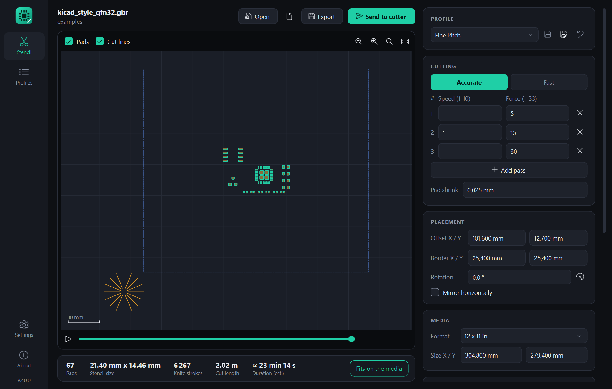
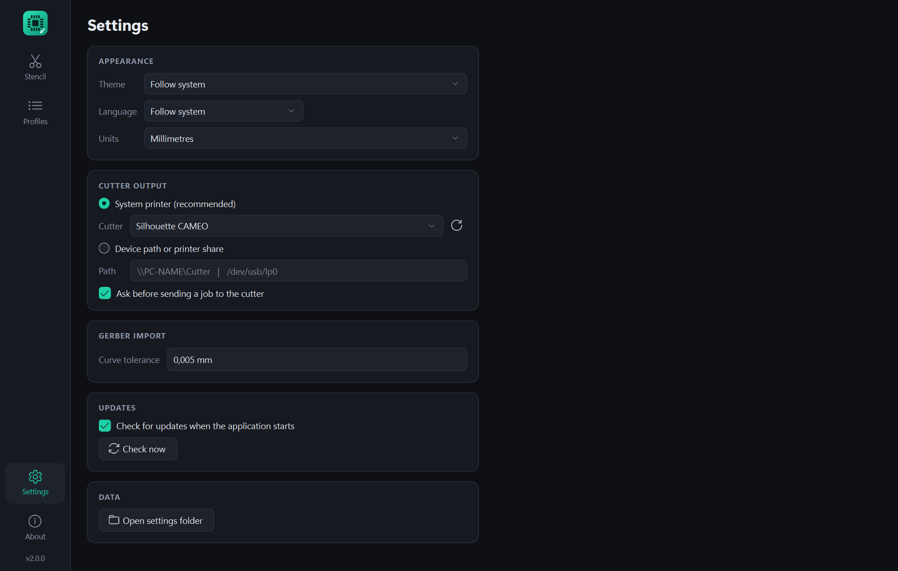
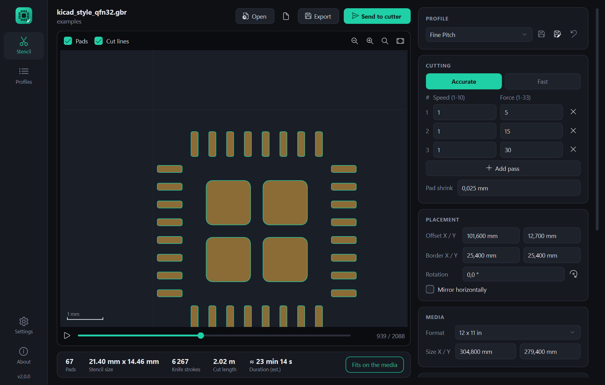
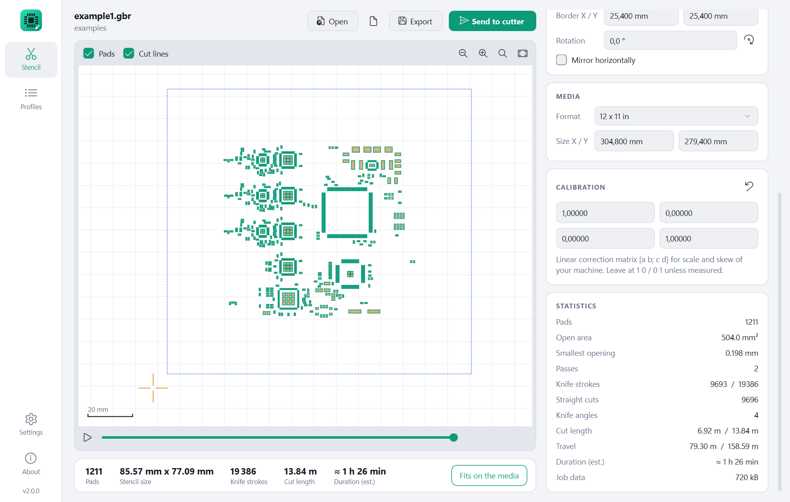
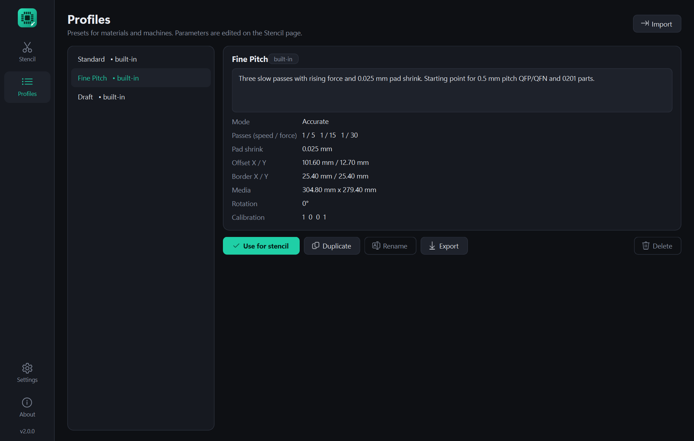

# Gerber2Graphtec - User Manual

[Deutsche Fassung](handbuch.md)

Gerber2Graphtec cuts solder paste stencils for SMT boards out of thin plastic
film on a Graphtec-based craft cutter such as the Silhouette Cameo or
Portrait. You load the solder paste layer of your board as a Gerber file,
check the preview, and send the job to the cutter.

- [1. What you need](#1-what-you-need)
- [2. Installation](#2-installation)
- [3. Connecting the cutter](#3-connecting-the-cutter)
- [4. Your first stencil](#4-your-first-stencil)
- [5. The Stencil page](#5-the-stencil-page)
- [6. Profiles](#6-profiles)
- [7. Settings](#7-settings)
- [8. How the cutting works](#8-how-the-cutting-works)
- [9. Finding good speed and force values](#9-finding-good-speed-and-force-values)
- [10. Calibrating the machine](#10-calibrating-the-machine)
- [11. Command line](#11-command-line)
- [12. Supported Gerber files](#12-supported-gerber-files)
- [13. Troubleshooting](#13-troubleshooting)



## 1. What you need

- A Graphtec-based cutter: Silhouette Cameo, Portrait or a similar machine
  that understands the Graphtec command language (GP-GL).
- Film: Mylar / polyester with a thickness of 0.08 to 0.12 mm (3 to 5 mil).
  Ordinary laser printer transparency film is usually in this range.
- The **solder paste layer** of your board as a Gerber file (RS-274X), for
  example `*.gtp` / `*.gbp`, KiCad `*-F_Paste.gbr`, or Eagle `*.GTP`.
- Windows 10 / 11 or Linux (x86-64).

## 2. Installation

**Windows.** Download `Gerber2Graphtec-x.y.z.exe` from the
[releases page](https://github.com/reserve85/gerber2graphtec-modern/releases/latest)
and start it. There is nothing to install; the file can live anywhere. The
program is not code-signed, so Windows may show a "Windows protected your PC"
notice on the first start - choose *More info > Run anyway*.

**Linux.** Download `Gerber2Graphtec-x.y.z-linux-x86_64.tar.gz`, unpack it
and start the contained `Gerber2Graphtec` file:

```bash
tar xzf Gerber2Graphtec-*-linux-x86_64.tar.gz
./Gerber2Graphtec
```

Alternatively run it from source with Python 3.10 or newer:

```bash
pip install .
gerber2graphtec
```

Your settings and profiles are stored per user in
`%APPDATA%\Gerber2Graphtec` (Windows) or `~/.config/Gerber2Graphtec` (Linux).
*Settings > Open settings folder* takes you there. Deleting the folder resets
the program.

## 3. Connecting the cutter

The program sends the job as raw data. It does not use the Silhouette
software or its driver. Choose the output once under
**Settings > Cutter output**:



### Windows

Select **System printer** and pick the cutter from the list. A printer whose
name contains "Silhouette", "Cameo", "Portrait" or "Graphtec" is preselected
automatically.

If the cutter is not in the list, it is not installed as a printer yet. The
approach used with the original gerber2graphtec was to add it manually in
*Printers & scanners* with the **Generic / Text Only** driver on the USB port
the cutter is connected to. After that, press the refresh button next to the
list.

As an alternative, select **Device path or printer share** and enter a UNC
share name such as `\\PC-NAME\Cutter`.

### Linux

Either select the print queue of the cutter (CUPS) under **System printer**,
or select **Device path** and enter the device node, usually `/dev/usb/lp0`.
For the device node your user needs to be in the `lp` group:

```bash
sudo usermod -a -G lp $USER     # then log out and in again
```

### Without a connection

You can always use **Export** to save the command file and send it to the
cutter by other means.

## 4. Your first stencil

1. **Open** the solder paste Gerber, or drop the file onto the window. To
   try the program without a board, use `examples/test_tiny.gbr` from the
   repository.
2. Choose a **profile**. *Standard* is the proven setting of the original
   tool; start with it.
3. Check the **preview**: the pads (gold), the frame cut (blue, dashed) and
   the knife training cuts (orange) must lie inside the sheet. The chip at
   the bottom right says *Fits on the media* or warns you.
4. Load the film into the cutter and set the blade.
5. Press **Send to cutter** and confirm.

Do the first cut of a new material on a scrap piece - see
[chapter 9](#9-finding-good-speed-and-force-values).

> **Orientation.** X and Y in the preview are the coordinates sent to the
> cutter. How they map to the feed direction and the carriage of your machine
> is easiest to find out with one test cut of `examples/corners.gbr` on scrap
> film. Adjust *Offset* and *Rotation* afterwards if needed.

## 5. The Stencil page

### Top row

| Control | Function |
|---|---|
| **Open** (`Ctrl+O`) | Load a Gerber file. Drag and drop works as well. |
| Recent files | The last 8 files. |
| **Export** (`Ctrl+E`) | Save the Graphtec command file (`*.graphtec`). |
| **Send to cutter** (`Ctrl+Enter`) | Send the job to the cutter chosen in the settings. |

`F5` reads the current file again, for example after a new export from your
CAD program.

Under the file name the program shows the folder, or a note about **import
warnings**. Hover over the note to read them - for example when the file
contains something that cannot be cut.

### Preview

| Action | Effect |
|---|---|
| Mouse wheel | Zoom at the cursor |
| Drag | Move the view |
| Double click | Fit the cut area |
| Buttons top right | Zoom out, zoom in, zoom to the stencil, show the whole sheet |
| **Pads** / **Cut lines** | Show or hide the layers |

The light rectangle is the media, with a 10 mm grid. The sheet outline turns
red if the cut does not fit. The cursor position on the media is shown at the
bottom right, a scale bar at the bottom left.

**Simulation.** The slider below the preview steps through the cuts in the
order the machine makes them; the play button runs them automatically. Cuts
already made are highlighted, the current one is orange.



### Status bar

Pads, stencil size, number of knife strokes, total cut length and the
estimated duration of the whole job. More figures are in the *Statistics*
card (see below).

### Parameters (right side)

All lengths can be shown in millimetres or inches
(*Settings > Units*). Every change updates the preview at once.

**Profile**

Select a profile to load its values. *modified* appears when you changed
something. The three buttons save the changes to the profile, save them as a
new profile, or discard them. Built-in profiles cannot be overwritten - use
*Save as new profile*.

**Cutting**

| Parameter | Meaning |
|---|---|
| **Accurate** | Every pad edge is cut as a single line. Slow, best quality, needed for fine pitch. |
| **Fast** | Every pad is cut as one closed outline. Much quicker, corners are less precise. |
| Passes | The job is cut once per row. **Speed** 1 (slow) to 10, **Force** 1 to 33. Up to 6 passes; a light first pass followed by a stronger one gives cleaner edges than one strong pass. |
| Pad shrink | Makes every opening smaller on all sides. The knife widens openings in thin film by roughly 0.05 mm (2 mil); 0.02 to 0.05 mm compensates for that. |

**Placement**

| Parameter | Meaning |
|---|---|
| Offset X / Y | Position of the stencil on the media. |
| Border X / Y | Distance of the frame cut around the stencil. 0 / 0 switches the frame cut off. |
| Rotation | Rotates the stencil counter-clockwise; the button adds 90 degrees. |
| Mirror horizontally | Flips the stencil. Usually not needed: a stencil can simply be turned over. |

Next to the frame, 12.7 mm (0.5 in) are reserved for the knife training cuts.
The lower left corner of the pad area therefore sits at
*Offset + Border + 12.7 mm*.

**Media**

Size of the film or the cutting area. The presets fill in common sizes; any
other size can be typed in. The program only uses it for the page definition
sent to the cutter and for the *Fits on the media* check.

**Calibration**

A correction matrix for machines that cut slightly too long, too short or
skewed. Leave it at `1 0 / 0 1` unless you have measured your machine
([chapter 10](#10-calibrating-the-machine)).

**Statistics**



| Figure | Meaning |
|---|---|
| Pads | Number of openings. |
| Open area | Total area of all openings. |
| Smallest opening | Narrowest pad dimension - shows how demanding the stencil is. |
| Passes | Number of passes. |
| Knife strokes | How often the knife is lowered and raised (per pass / total). |
| Straight cuts | Number of straight segments per pass. |
| Knife angles | Number of angle groups, each started by a training cut (accurate mode). |
| Cut length | Distance with the knife down (per pass / total). |
| Travel | Distance with the knife up between cuts (per pass / total). |
| Duration (est.) | Rough estimate; see the note below. |
| Job data | Size of the data sent to the cutter. |

The **duration** is calculated from a simple model: one speed unit = 10 mm/s,
travel at 100 mm/s, 0.15 s per knife stroke, plus 10 s for loading. Real
machines differ; use it to compare settings, not as a promise.

## 6. Profiles



A profile stores all parameters of the Stencil page - one per material,
blade or machine is a good habit.

| Built-in profile | Content |
|---|---|
| **Standard** | Accurate mode, two passes (speed 2, force 8 and 30). The defaults of the original tool for 3 to 5 mil film. |
| **Fine Pitch** | Three slow passes with rising force (5, 15, 30) and 0.025 mm pad shrink. A starting point for 0.5 mm pitch parts and 0201. |
| **Draft** | Fast mode, one pass. For large pads and test cuts. |

*Fine Pitch* and *Draft* are starting points, not measured values.

On the **Profiles** page you can duplicate, rename, delete, export and import
profiles (JSON files, handy for sharing or backup) and write a description.
*Use for stencil* loads the selected profile on the Stencil page. The
parameters themselves are edited on the Stencil page and saved from there.

## 7. Settings

| Setting | Meaning |
|---|---|
| Theme | Dark, light, or follow the system. |
| Language | German, English, or follow the system. Takes effect after a restart. |
| Units | Millimetres or inches for all length inputs. |
| Cutter output | See [chapter 3](#3-connecting-the-cutter). |
| Ask before sending | Shows a confirmation with the pass settings before a job starts. |
| Curve tolerance | Maximum deviation when round pads and arcs are turned into straight cuts (default 0.005 mm). A larger value gives fewer, longer cuts and a faster job; a smaller value gives rounder openings. |
| Updates | Check for a newer version at start, or with *Check now*. Nothing is installed automatically - the program only opens the download page. |

## 8. How the cutting works

A drag knife trails behind its pivot. When it changes direction inside a
tiny pad, the tip does not follow exactly and corners come out rounded or
torn. The **accurate** mode avoids this:

- Every edge of every pad is cut as an **individual straight line**, and each
  edge is cut **twice, once in each direction**.
- All lines are **grouped by direction** (16 knife angles). The machine cuts
  all lines of one direction before it moves on to the next.
- Before each group, a short **training cut** outside the stencil (the orange
  star at the lower left) swivels the knife into the right direction.
- Each line starts slightly early and ends slightly late to make up for
  mechanical play.
- The whole sequence is repeated for every **pass**.

This takes many knife strokes - a board with 1 200 pads needs almost 10 000 per pass -
so accurate jobs are slow. That is the price of clean 0.5 mm pitch openings.
The **fast** mode cuts each pad outline in one go and suits large pads.

## 9. Finding good speed and force values

The right values depend on film, blade wear and blade depth, so they have to
be found by trying:

1. Load `examples/test_tiny.gbr` (9 pads, roughly a minute) or a small
   part of your own board.
2. Start with the *Standard* profile and a blade depth just a little more
   than the film thickness.
3. Cut, then check against a light: pads should fall out or lift out easily
   and edges should be clean.
4. Pads not cut through: raise the **force of the last pass**, or add a pass.
5. Film tears, pads are distorted, or the backing mat is cut deeply: lower the
   force, lower the speed, or reduce the blade depth.
6. Openings too large for fine pitch: increase **Pad shrink** in steps of
   0.01 mm.
7. Save the result as your own profile.

`examples/fine_pitch_sampler.gbr` contains a range of pad sizes and pitches
and shows how small your setup can go.

## 10. Calibrating the machine

Only needed if stencils do not line up with the board over larger distances.

1. Load `examples/corners.gbr`. It has four 1 mm square pads whose centres
   are exactly 126.0 mm (4.9606 in) apart in X and in Y.
2. Cut it with the matrix at `1 0 / 0 1`.
3. Measure the distance between the pad centres in X and in Y.
4. Enter the factors *nominal / measured*:

   - top left field (a) = 126.0 / measured X distance
   - bottom right field (d) = 126.0 / measured Y distance

   Example: X measures 125.8 mm, so a = 126.0 / 125.8 = 1.00159.
5. The other two fields (b, c) correct skew, i.e. axes that are not exactly
   perpendicular. Leave them at 0 unless the square comes out as a
   parallelogram.

The matrix maps stencil coordinates to cutter coordinates:
`x' = a*x + b*y`, `y' = c*x + d*y`. Save it in your profile.

## 11. Command line

`g2g-cli` creates the same job without the window (available when installed
from source with `pip install .`):

```bash
g2g-cli paste.gbr -o stencil.graphtec                  # write a command file
g2g-cli paste.gbr --printer "Silhouette CAMEO"          # send to a printer
g2g-cli paste.gbr > /dev/usb/lp0                        # Linux device node
g2g-cli paste.gbr --profile "Fine Pitch" --rotate 90 --inset 0.03 -o out.graphtec
g2g-cli --list-printers
```

Options: `--profile`, `--offset X,Y`, `--border X,Y`, `--media-size W,H`,
`--matrix A,B,C,D`, `--speed S[,S2..]`, `--force F[,F2..]`,
`--mode accurate|fast`, `--rotate DEG`, `--mirror`, `--inset`, and `--inch`
to give lengths in inches instead of millimetres. Profiles created in the
application can be used by name.

## 12. Supported Gerber files

The reader understands RS-274X as written by KiCad, Eagle, Altium, gEDA and
others:

- inch and millimetre files, all coordinate formats, leading or trailing zero
  omission
- standard apertures: circle, rectangle, obround, polygon (with holes)
- aperture macros, including the rounded rectangles KiCad uses for pads
- flashes, lines and arcs, regions (`G36` / `G37`)
- dark and clear polarity, aperture rotation / mirroring / scaling

Not supported, with a warning on import: step & repeat (`SR`), block
apertures (`AB`), negative image polarity.

Things to know:

- Overlapping features are merged into one opening.
- Lines with (nearly) zero width are ignored; some programs use them to
  outline areas.
- A pad with a hole is cut along its outer outline only - the island in the
  middle would fall out.
- Use the paste layer, not the copper or mask layer. Many CAD programs can
  shrink paste openings on export; alternatively use *Pad shrink*.

## 13. Troubleshooting

| Problem | What to do |
|---|---|
| *No cutter is configured yet* | Choose the cutter under *Settings > Cutter output*. |
| The cutter is not in the printer list | Install it as a printer (see chapter 3), then press refresh. |
| *Sending failed* | The message shows the system error. Check cable, power and that the printer queue is not paused. |
| The job is sent but nothing happens | Check for stuck jobs in the printer queue, and that the machine is loaded and ready before you send. |
| *Exceeds the media* | Reduce *Offset* or *Border*, rotate the stencil, or enter the real media size. |
| *The file contains no pads* | The file is probably another layer (outline, silkscreen) or empty. |
| *The file could not be read* | It is not a Gerber file - drill files and zip archives do not work. |
| Pads are missing or look wrong | Read the import warnings (hover over the line below the file name). Please report the file as an [issue](https://github.com/reserve85/gerber2graphtec-modern/issues). |
| *Nothing left to cut* | *Pad shrink* is larger than half the pad width. |
| Pads are not cut through / film tears | See [chapter 9](#9-finding-good-speed-and-force-values). |
| Round pads have visible corners | Lower *Curve tolerance* in the settings. |
| The job takes very long | Normal in accurate mode. Use fewer passes, a larger curve tolerance, or the fast mode for coarse boards. |
| Stencil is rotated or mirrored on the film | Use *Rotation* / *Mirror* and save the profile. |
| Update check fails | No internet connection or GitHub not reachable; the program works without it. |
| Start over | Delete the settings folder (*Settings > Open settings folder*). |

Keyboard shortcuts: `Ctrl+O` open, `Ctrl+E` export, `Ctrl+Enter` send,
`F5` reload file, `Ctrl+,` settings.
